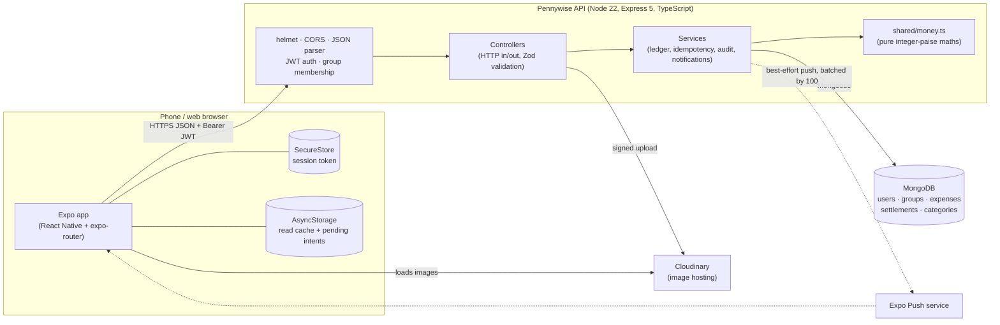
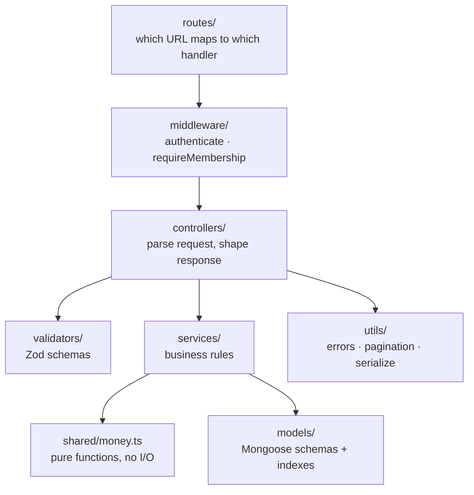
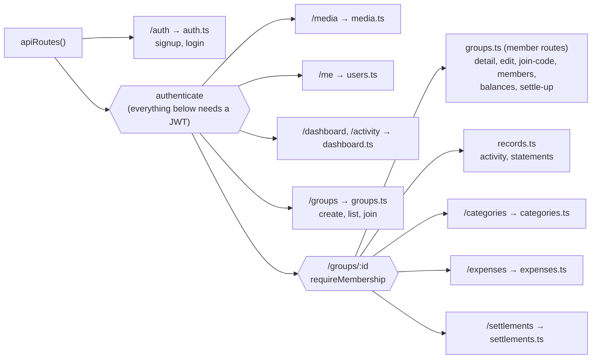
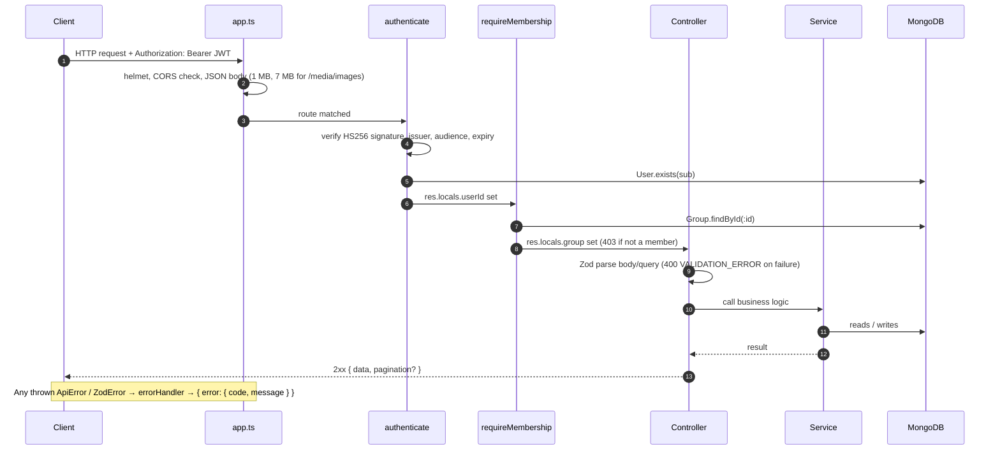
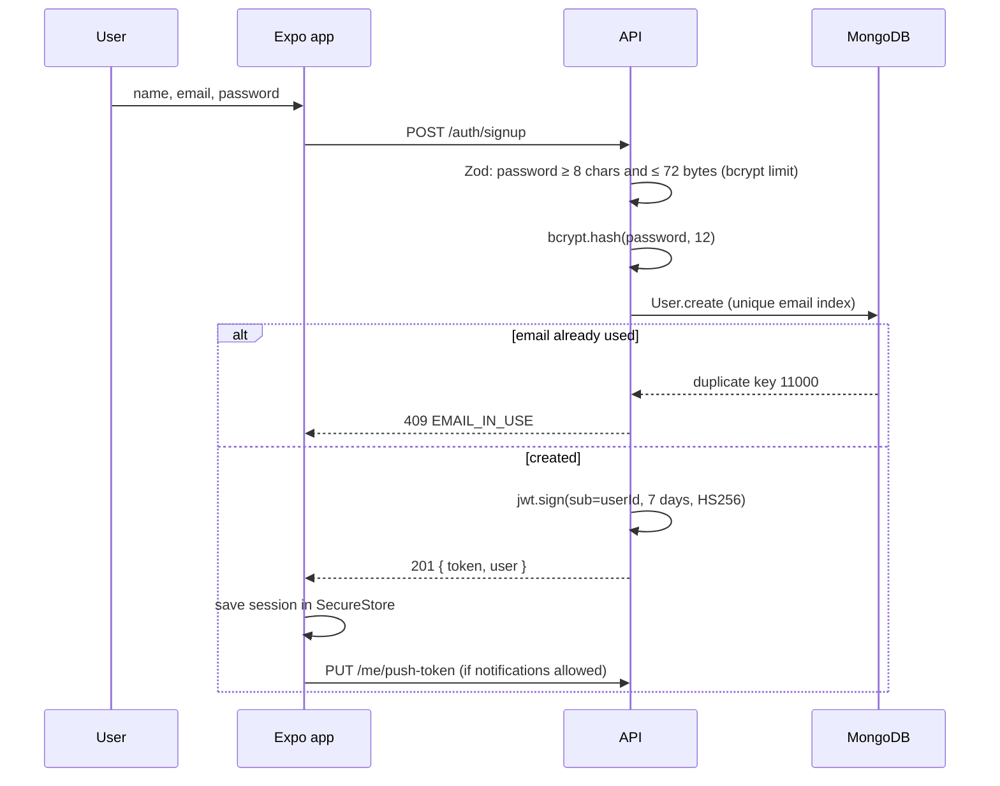
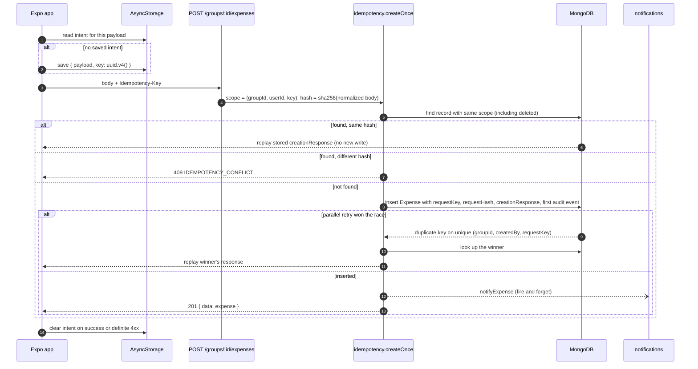
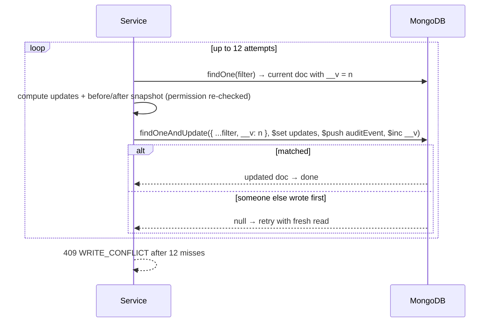
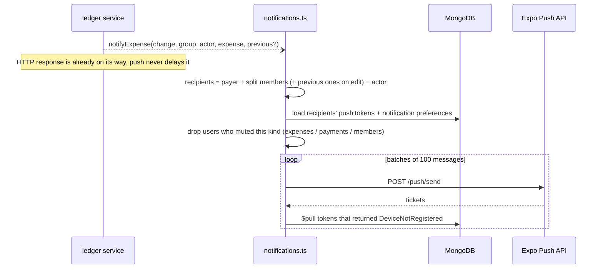

# Pennywise architecture

How the system is put together and why. For endpoint details see [api.md](api.md); for running it see [backend-setup.md](backend-setup.md). Related deep dives: [data-model.md](data-model.md), [balances-and-settlement.md](balances-and-settlement.md), [user-flows.md](user-flows.md), [testing.md](testing.md).

## High-level design

| Component | Responsibility |
| --- | --- |
| **Expo client** | All UI. Holds the JWT in SecureStore, caches successful reads per account in AsyncStorage, and blocks writes while offline. |
| **Express API** | Stateless REST API. Every request is authenticated by JWT; group routes additionally load the group and check membership. |
| **MongoDB** | Single source of truth. No running totals are stored; balances are always recomputed from the ledger. |
| **Expo Push** | Delivers notifications for expenses, payments and new members. Failures never affect the write that triggered them. |
| **Cloudinary** | Stores profile and group photos. The server signs uploads so the API secret never reaches the client. |

The server is stateless apart from in-memory rate-limit counters, so it can run as a single Docker container (see `server/Dockerfile` and `server/compose.yaml`).

## Server layers

| Folder | Rule of thumb |
| --- | --- |
| `routes/` | One file per resource. No logic, only mounting. |
| `middleware/` | Cross-cutting request checks. `requireMembership` puts the group on `res.locals` so controllers never re-query it. |
| `controllers/` | Thin: validate input with Zod, call a service, serialize the result. |
| `services/` | Everything that touches more than one document or has a business rule (permissions, idempotency, audit, notifications). |
| `shared/money.ts` | Pure, framework-free arithmetic on integer paise using `BigInt`. Easy to unit test. |
| `models/` | One file per collection, plus `shared.ts` for fields that expenses and settlements have in common. `index.ts` re-exports everything. |
| `utils/` | `ApiError` + the global error handler, pagination helpers, and `*View` serializers that decide which fields leave the server. |

### Route map

`routes/index.ts` only composes the per-resource routers. Order matters in two places, called out below.

1. `/auth` is mounted **before** `authenticate`, so signup and login work without a token.
2. `/groups` is mounted **before** `/groups/:id`. Otherwise `POST /groups/join` would be read as a group whose id is `join` and rejected by `requireMembership`.

`/health`, `/openapi.json` and the Swagger UI at `/docs` are registered directly in `app.ts`, outside the authenticated router.

## Request lifecycle

Every request passes the same chain. Errors at any step are thrown and turned into `{ "error": { "code", "message" } }` by one handler in `utils/errors.ts`.

## Key flows

### Sign up and log in

Login always runs `bcrypt.compare`, even for unknown emails (against a fixed dummy hash). That way response time and the error message (`INVALID_CREDENTIALS`) don't reveal whether an account exists.

### Add an expense (idempotent create)

Mobile networks drop responses. If the client retries a create, the server must not record the expense twice. The client stores an **intent** (the request body plus a UUID key) *before* sending, and reuses that key on any retry, even after an app restart.

The key, hash and original response live **inside the expense document**, so there is no second collection to keep consistent. That works on a standalone MongoDB without transactions.

### Edit with an audit trail (optimistic concurrency)

Edits, deletes, renames and joins go through `services/audit.ts → auditedUpdate`, which applies the change and appends the audit event in a single document write:

Because the version check and the audit push happen in the same atomic update, an audit entry can never describe a state that was not actually written.

### Push notification fan-out

Push failures are logged and swallowed. Initial sends remain best-effort. Accepted ticket IDs and tokens (no notification bodies) are stored in the `PushReceipt` collection. A background poll claims due receipts with a 15-minute lease, checks Expo delivery receipts, reports provider error codes, and prunes `DeviceNotRegistered` tokens. Missing receipts and failed lookups retry; a 24-hour TTL bounds retention. The lease avoids overlapping processing across polls/replicas. `flushNotifications()` lets tests and graceful shutdown wait for in-flight pushes and receipt checks before disconnecting MongoDB.

## Client architecture

| Piece | File | Role |
| --- | --- | --- |
| Routing | `client/src/app/` | expo-router file-based routes. `_layout.tsx` uses `Stack.Protected` to switch between the signed-out stack (welcome, login, signup) and the signed-in `(app)` stack. |
| App state | `providers/app-provider.tsx` | Session, theme, offline flag, pending join code, and a cache `invalidate()` used after every write. |
| Reads | `hooks/use-resource.ts` | Fetch + per-account cache. Offline reads serve cached data, and a 404/403 drops the cached entry. |
| Writes | `hooks/use-mutation.ts` | Single-flight lock, offline guard, persistent idempotency intents for creates. |
| HTTP | `lib/api.ts` | Adds `Authorization` and `Idempotency-Key`, and expires the session on any 401. |
| Push | `hooks/use-push-notifications.ts`, `lib/push.ts` | Registers the Expo token, removes it on logout, and routes a notification tap to `/group/[id]`. |

## Design decisions

| Decision | Why |
| --- | --- |
| **Money as integer paise** (`amountCents`) with `BigInt` sums | Floating point can't represent 0.1 exactly. Integers plus a `Number.isSafeInteger` check mean balances always sum to exactly zero. Overflow returns `422 BALANCE_OVERFLOW` instead of a silently rounded value. |
| **Server-side splits** | The server computes equal shares, so two clients can never disagree about who owes what. Custom splits must add up to the total exactly. |
| **Balances are derived, never stored** | No running totals to drift out of sync. Editing or deleting an old expense is automatically reflected everywhere. |
| **Soft delete** (`deletedAt`) | Idempotent retries of a deleted record replay the original response instead of re-creating it, and history stays intact. |
| **Audit events embedded in each document** | Action and history commit in one atomic write, without needing replica-set transactions. |
| **Category snapshot on expenses** | Expenses store a copy of the category's name, icon and colour, so renaming or archiving a category never rewrites history. |
| **Best-effort push** | A slow or failing Expo service must never block or fail recording an expense. |

## Known limitations

- Rate limits (global, auth, join, upload) use in-memory counters, so they reset on restart and are per instance. Use a shared store before running more than one instance.
- Logout is device-local. A copied JWT stays valid until it expires (7 days) or `JWT_SECRET` is rotated. There are no refresh tokens or password reset.
- Full-ledger reads (balances, statements) are not a single cross-collection snapshot during concurrent edits.
- Embedded audit histories grow with each change and share MongoDB's 16 MiB document limit.
- No offline write queue. The client disables writes while offline.
