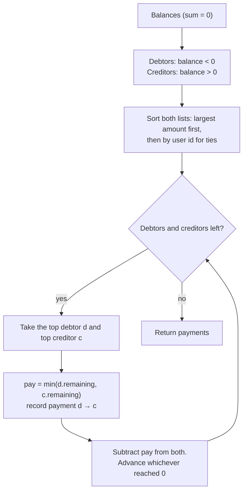
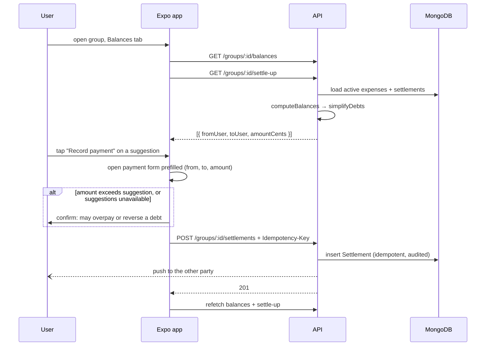

# Balances and settle-up

How Pennywise turns a list of expenses and payments into "who owes whom". All the maths lives in `server/src/shared/money.ts` as pure functions; `services/ledger.ts` loads data and calls them.

All amounts are **integer paise** (₹1 = 100 paise) and summed with `BigInt`, so no rounding can creep in.

## 1. Splitting an expense

The client sends a split mode, and the server works out every share:

| `splitMode` | Who is included | How shares are computed |
| --- | --- | --- |
| `all` | Everyone currently in the group, captured at save time | Equal split |
| `allExcept` | Everyone except `excludedUserIds` | Equal split |
| `selected` | `splitUserIds` | Equal split |
| `custom` | Users in `customSplits` | Exactly as given; must add up to `amountCents` |
| *(omitted on edit)* | The expense's original participants | Equal split, recalculated for the new amount |

### Equal split and the leftover paisa

`equalSplit(amountCents, userIds)`:

1. Sort participants by user id, so the result is deterministic.
2. `base = floor(amount / n)`, `remainder = amount mod n`.
3. The first `remainder` participants get `base + 1`; everyone else gets `base`.

Example: ₹100.00 (`10000`) split three ways gives `3334, 3333, 3333`. The total is exactly `10000`. Sorting by id means the extra paisa always goes to the same person, whichever client sent the request.

## 2. Computing balances

A **balance** is how much the group owes a member (positive) or how much they owe the group (negative).

```
balance(u) =   Σ amountCents of expenses u paid
             − Σ shareCents  of u across all expenses
             + Σ settlements u sent
             − Σ settlements u received
```

A settlement moves the sender **up** (they paid off debt) and the receiver **down** (they've been paid back).

`computeBalances(memberIds, expenses, settlements)` applies this to every **non-deleted** expense and settlement, then checks:

- every referenced user is a current member,
- every expense's splits add up to its amount,
- nobody paid themselves,
- **the balances sum to exactly zero**,
- every balance fits in a safe JS integer (otherwise `422 BALANCE_OVERFLOW`).

Nothing is cached. `GET /groups/:id/balances` recomputes from the full ledger every time, so editing or deleting an old record is reflected immediately.

> **Race guard:** `balancesFor` reloads the group's member list *after* reading the ledger. If someone joins and adds an expense mid-request, their id is still recognised as a member instead of triggering a "non-member in ledger" error.

## 3. Suggesting repayments (greedy settle-up)

`simplifyDebts(balances)` turns balances into a short list of payments:



Each step settles at least one person completely, so a group of *n* people with non-zero balances needs **at most n − 1 payments**. Greedy isn't always the absolute minimum (finding that is NP-hard), but it's fast, deterministic, and close in practice.

## 4. Worked example

Four flatmates: **A**, **B**, **C**, **D**.

| # | Record | A | B | C | D |
| --- | --- | ---: | ---: | ---: | ---: |
| 1 | A pays ₹800 groceries, split evenly among all 4 (₹200 each) | +600 | −200 | −200 | −200 |
| 2 | B pays ₹400 for a cab, split between C and D only (₹200 each) | +600 | +200 | −400 | −400 |
| 3 | Settlement: D pays A ₹200 | +400 | +200 | −400 | −200 |
| | **Balance** (sums to 0 ✓) | **+400** | **+200** | **−400** | **−200** |

Settle-up:

| Step | Debtors (remaining) | Creditors (remaining) | Payment |
| --- | --- | --- | --- |
| 1 | C 400, D 200 | A 400, B 200 | **C → A ₹400** (both settled) |
| 2 | D 200 | B 200 | **D → B ₹200** (both settled) |

Result: 2 payments, not the 4 you'd get if everyone paid each original payer back separately.

## 5. Recording a payment



Any member can record, edit or delete a payment, so the group has to trust its members. Pennywise records payments made elsewhere (cash, UPI) and never moves money itself.

## 6. Statements

`GET /groups/:id/statements` gives a running-balance view built from the same ledger:

- `view=member` (default): every expense and payment involving one member, oldest first. Each row's `deltaCents` is *paid − share* for an expense, or *sent − received* for a payment, and `balanceCents` is the running total.
- `view=spending`: every expense, with its full amount as the delta, for "how much did this group spend".

When paginating, `openingBalanceCents` carries the running total in from earlier pages, so page 2 starts where page 1 left off.

## Where it's tested

`server/tests/unit/money.test.ts` covers the pure functions (equal-split remainders, zero-sum checks, overflow, greedy output). `server/tests/api/backend.test.ts` covers balances after edits, deletes and settlements, overflow `422`s, and the member-joins-mid-request race. See [testing.md](testing.md).
