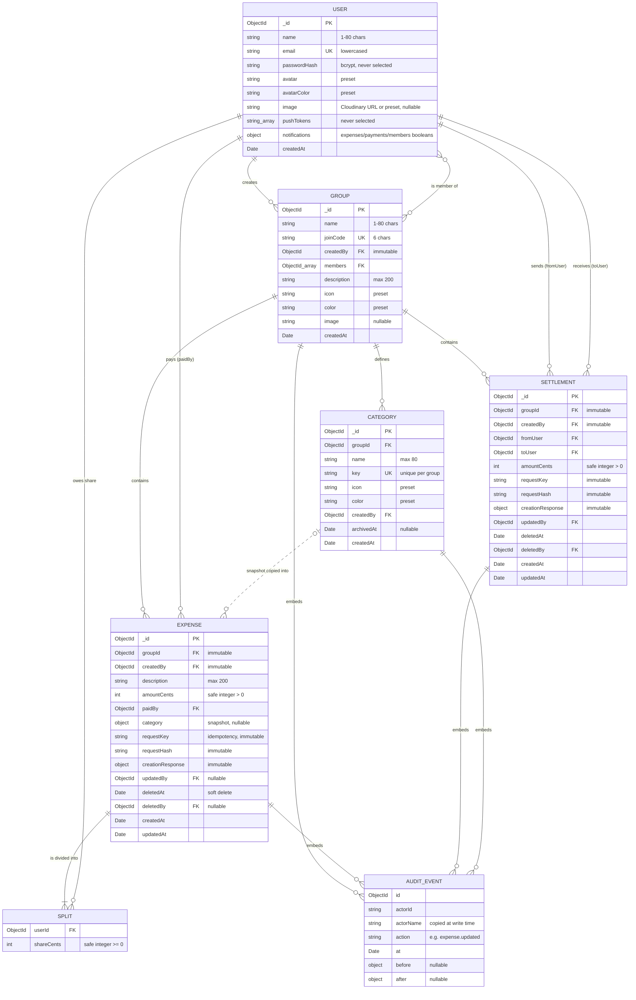

# Pennywise data model

MongoDB collections defined in `server/src/models/`, one file per collection. Fields shared by expenses and settlements live in `models/shared.ts`.

## Entity-relationship diagram

`SPLIT` and `AUDIT_EVENT` are **embedded sub-documents**, not collections. Splits live in `expense.splits[]`; audit events live in each parent's `auditEvents[]` (hidden by `select: false`).

## Collections

### users (`models/user.ts`)

| Field | Notes |
| --- | --- |
| `email` | Unique index; trimmed and lowercased before saving. |
| `passwordHash` | bcrypt cost 12. `select: false`, so it's only loaded explicitly during login. |
| `pushTokens` | One Expo token per signed-in device. Indexed so a token can be moved to whichever account signed in on that device last. Never serialized. |
| `notifications` | Per-kind opt-out (`expenses`, `payments`, `members`); all default to `true`. |

### groups (`models/group.ts`)

| Field | Notes |
| --- | --- |
| `joinCode` | Unique index. Six characters from `ABCDEFGHJKMNPQRSTUVWXYZ23456789`, which leaves out look-alikes such as `0/O` and `1/I/L`. Rotating it invalidates the old code. |
| `members` | Array of user ids; indexed so "my groups" is a single index lookup. Membership only grows in this version. |
| `createdBy` | Immutable. Only the creator may edit group details or rotate the code. |

### expenses (`models/expense.ts`)

| Field | Notes |
| --- | --- |
| `amountCents` | Integer paise (₹1 = 100). |
| `splits[]` | `{ userId, shareCents }`. A `pre('validate')` hook rejects any document whose shares don't add up to `amountCents` (summed with `BigInt`). |
| `category` | A **copy** of `{ id, name, icon, color }` taken when the expense is saved, so later category edits don't rewrite history. |

### settlements (`models/settlement.ts`)

A payment recorded outside the app ("Asha paid Ravi ₹500"). Pennywise never moves money.

### categories (`models/category.ts`)

Unique index on `(groupId, key)`. Archiving sets `archivedAt`; archived categories can't be picked for new expenses but stay on old ones.

## Shared creation fields (`models/shared.ts`)

Expenses and settlements share these fields through `creationFields`:

| Field | Purpose |
| --- | --- |
| `groupId`, `createdBy` | Immutable owner/scope. |
| `requestKey` | Client `Idempotency-Key`. |
| `requestHash` | SHA-256 of the normalized request body. The same key with a different body gives `409 IDEMPOTENCY_CONFLICT`. |
| `creationResponse` | The exact response from the first create, replayed on retries. |
| `updatedBy`, `deletedAt`, `deletedBy` | Edit tracking and soft delete. |
| `auditEvents` | Embedded history. |

## Indexes

| Collection | Index | Used for |
| --- | --- | --- |
| users | `{ email: 1 }` unique | Login, duplicate-signup detection |
| users | `{ pushTokens: 1 }` | Moving or pruning a device token |
| groups | `{ joinCode: 1 }` unique | Join by code, collision-safe code generation |
| groups | `{ members: 1 }` | "Groups I belong to" |
| expenses, settlements | `{ groupId: 1 }` | Loading a group's full ledger for balances |
| expenses, settlements | `{ groupId: 1, createdAt: -1, _id: -1 }` | Newest-first pagination |
| expenses, settlements | `{ groupId: 1, createdBy: 1, requestKey: 1 }` unique | Idempotent creation; the race loser hits this and replays the winner |
| categories | `{ groupId: 1, key: 1 }` unique | No duplicate category names per group |

`ensureIndexes()` in `models/index.ts` builds all of these at startup before the server accepts requests.

## Invariants

These rules always hold. Each one is enforced by the schema, a service, or both.

1. **Money is a positive safe integer.** `amountCents` must satisfy `Number.isSafeInteger(n) && n > 0`. Shares may be `0`.
2. **Splits add up to the total.** Checked in the schema hook and again in `computeBalances`.
3. **Everyone in an expense or settlement is a group member.** `checkMembers` in `services/ledger.ts`.
4. **Nobody pays themselves.** `fromUser !== toUser`.
5. **A group's balances sum to zero.** `computeBalances` throws if they don't.
6. **Deleted records stay in the database** (`deletedAt`), are excluded from balances and normal lists, and can't be brought back by retrying their original create.
7. **Ownership fields can't change.** `groupId`, `createdBy`, `requestKey`, `requestHash` and `creationResponse` are `immutable` in Mongoose.

## Soft-delete visibility

| Record | Normal list | Balances | Activity history | Idempotent retry |
| --- | --- | --- | --- | --- |
| Deleted expense | Hidden | Excluded | Shown as `expense.deleted` | Replays original response |
| Deleted settlement | **Still listed**, with `deletedAt`/`deletedBy` set, so the group's payment history stays complete | Excluded | Shown as `payment.deleted` | Replays original response |
