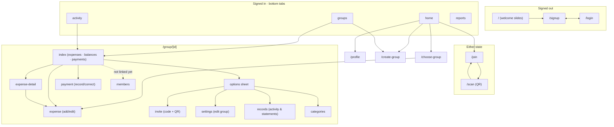
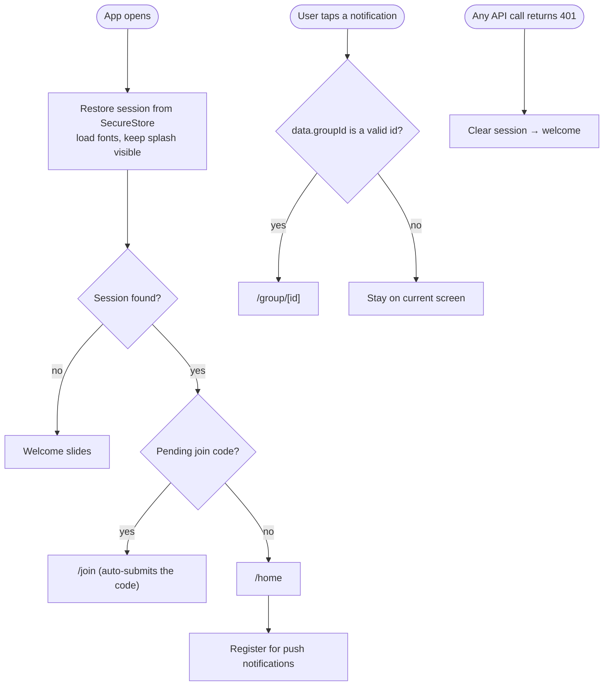
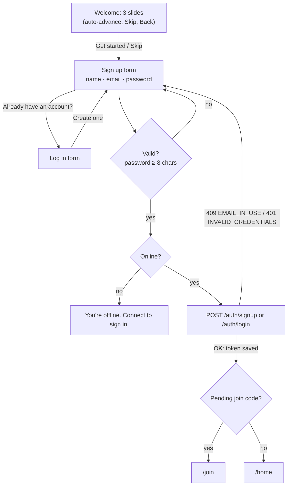
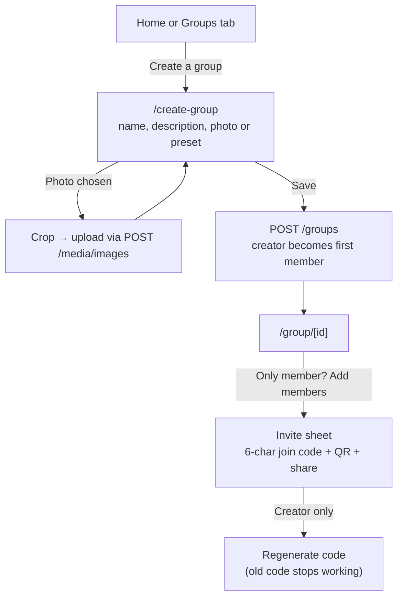
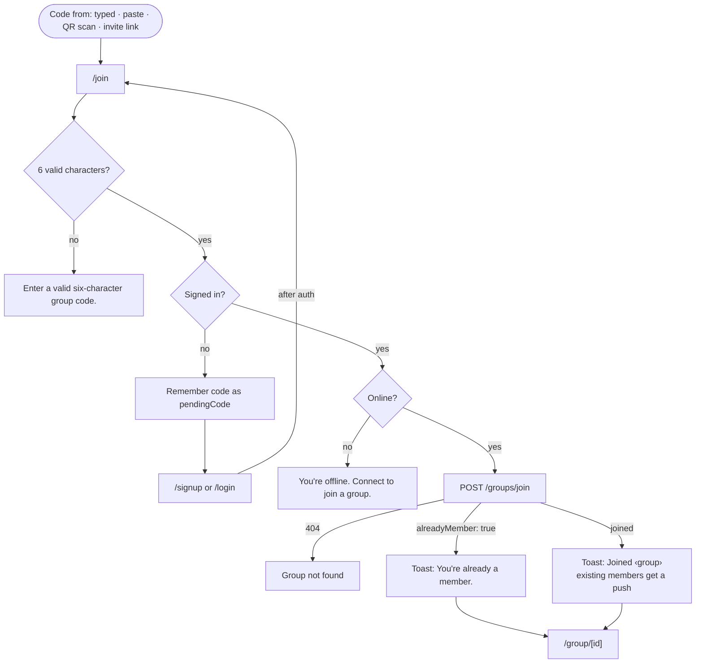
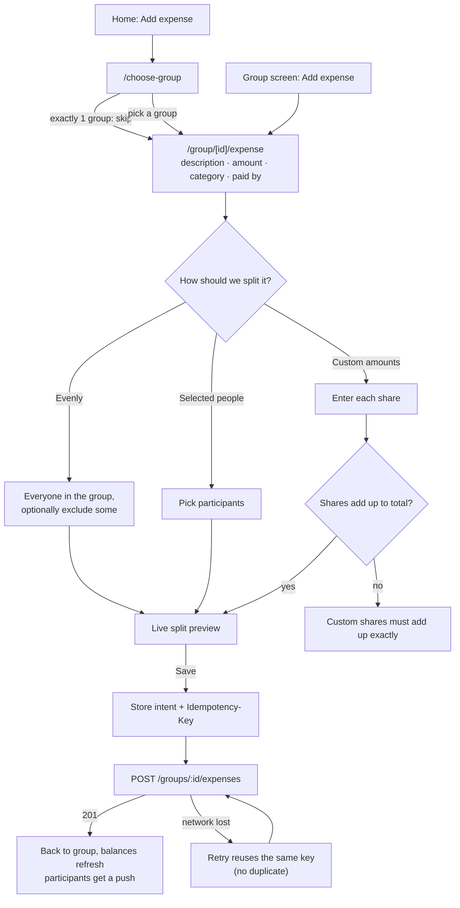
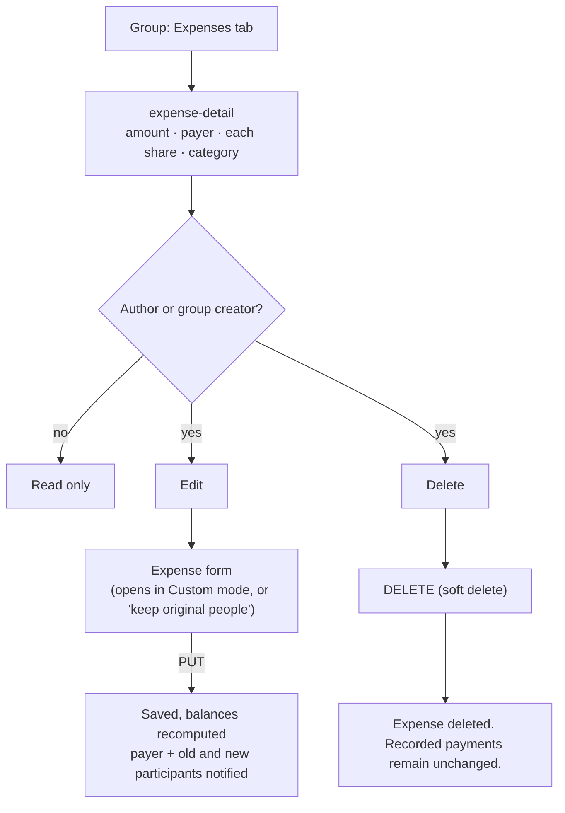
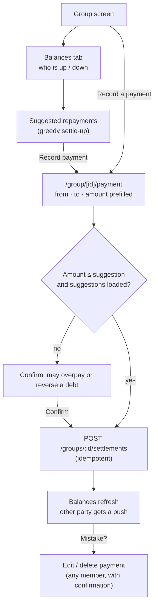

# Pennywise user flows

What a person does in the app, screen by screen. Screen paths are files under `client/src/app/`. The API calls behind each step are in [api.md](api.md); the server side is in [architecture.md](architecture.md).

## Screen map

> `members.tsx` (search members and see their balances) exists, but no screen links to it yet. Only a direct route opens it.

## 1. App launch and routing

`client/src/app/_layout.tsx` uses `Stack.Protected` guards, so a user can never land on a screen that doesn't match their sign-in state.

## 2. Onboarding (sign up / log in)

## 3. Create a group and invite people

## 4. Join a group

Codes can arrive four ways: typed, pasted, a QR scan, or an invite link (`/join?code=…`). If the user isn't signed in yet, the code is **remembered** through signup or login and used automatically afterwards.

## 5. Add an expense

## 6. View, edit or delete an expense

## 7. Settle up

See [balances-and-settlement.md](balances-and-settlement.md) for how the suggestions are calculated.

## 8. Records, reports and profile

| Where | What the user can do |
| --- | --- |
| **Activity tab** | Cross-group feed of expense and payment events, filterable. Tap an item to open its group. |
| **Reports tab** | Spending per group and the user's balance in each. |
| **Group → Options → Activity & statements** | The group's audit history (filter: expenses, payments, group, categories) and a running-balance statement per member or for total spending. |
| **Group → Options → Categories** | Any member can add a custom category. Only the group creator can rename, archive or restore one; standard categories are read-only. |
| **Group → Options → Edit group** | Name, description, photo. Creator only. |
| **Profile** | Display name, avatar or photo, theme (system/light/dark), per-type notification switches, log out (removes this device's push token). |

## Offline behaviour

- Screens show the last cached data for the signed-in account.
- Every write button is disabled, with a "You're offline" message.
- There's no offline queue. A create that was interrupted mid-request is retried with its original idempotency key once the user taps Save again.
